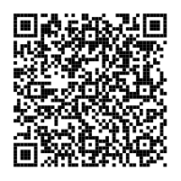

# 🚑 환자 수용 요청 (Patient Acceptance Request)

현장 경찰관이 휴대폰으로 **수용 요청**을 보내면, 참여 병원 관계자 휴대폰·PC에 바로 표시되고
병원은 버튼 하나로 **수용 가능 / 수용 불가 / 전화 확인**을 회신하는 웹앱입니다.

- **완전 무료** — Google 계정 하나면 됩니다 (VM, Firebase, 스프레드시트, 외부 API 키 모두 불필요)
- **설치 없음** — 사용자는 웹앱 링크만 열면 됩니다 (앱 설치·회원가입 없음)
- **자동 삭제** — 응답 대기 요청은 60분, 종료된 요청은 10분 후 자동 삭제

## 동작 방식

```
경찰관 휴대폰 ──요청──▶ Google Apps Script (무료 서버) ◀──응답── 병원 휴대폰/PC
               ◀──────────── 4초마다 자동 갱신 ─────────────▶
```

| 사용자 | 할 수 있는 일 |
|---|---|
| 👮 경찰관 | 환자 유형·지역·상태 입력 → 참여 병원 전체에 요청 → 응답 실시간 확인 → **이송 결정** 또는 취소 |
| 🏥 병원 | 담당 지역 요청 수신 → **응답할 때까지 3초마다 소리·진동·빨간 경고 반복** → 수용 가능/불가/전화 확인 회신 → 이송 결정 알림 수신 |

병원끼리는 서로의 병원명을 볼 수 없고 응답 집계(가능 n곳 등)만 봅니다.

## 설치 (관리자 1회, 약 5분)

1. https://script.google.com 접속 → **새 프로젝트**
2. 기본 `Code.gs` 내용을 지우고 이 저장소의 [`Code.gs`](Code.gs) 내용을 붙여넣기
3. 왼쪽 **파일 ＋ → HTML** → 이름을 `Index` 로 만들고 [`Index.html`](Index.html) 내용을 붙여넣기
4. 편집기 위쪽 함수 목록에서 **`setup`** 을 고르고 **실행** → 권한 승인
   (병원 Gmail로 알림 메일을 보내는 권한을 승인하고, 재알림 트리거를 설치합니다. 1회만)
5. (선택, 권장) **프로젝트 설정(⚙) → 스크립트 속성 → 속성 추가**
   `ACCESS_CODE` = 원하는 숫자/문자 (예: `2580`) → 사용자가 처음 접속할 때 이 코드를 입력해야 합니다
6. 오른쪽 위 **배포 → 새 배포 → 유형: 웹 앱**
   - 실행 계정: **나**
   - 액세스 권한: **모든 사용자** (경찰관·병원이 Google 로그인 없이 바로 접속)
7. 권한 승인 후 나오는 **웹 앱 URL**(`https://script.google.com/macros/s/.../exec`)을 경찰관·병원에 공유

> 코드를 수정한 뒤에는 **배포 → 배포 관리 → 수정(연필) → 버전: 새 버전**으로 다시 배포해야 같은 URL에 반영됩니다.

## 바로 접속 (QR 코드)

휴대폰 카메라로 찍으면 웹앱이 열립니다. 경찰관·병원 모두 **같은 주소**이고, 처음 열 때 역할을 고릅니다.
처음 접속할 때 관리자에게 받은 **접속 코드**가 필요합니다 (코드는 이 저장소에 없습니다).

| 👮 경찰관용 | 🏥 병원용 |
|:---:|:---:|
|  |  |
| 열고 **👮 경찰관** 선택 | 열고 **🏥 병원** 선택 |

주소: https://script.google.com/macros/s/AKfycbzUY5lCQvM-nMOELQE1zuknDdYIaGMJzfeEK70EXPkzQQYOwMZQrl9MIHmMMSliGNzoCg/exec

## 사용 방법

1. 받은 링크(또는 위 QR)를 휴대폰에서 열고 **홈 화면에 추가**해 두면 앱처럼 쓸 수 있습니다.
2. 처음 한 번만 **경찰관 / 병원** 을 고르고 소속·병원명을 입력합니다 (휴대폰에 저장됨).
3. 병원 측은 화면을 켜 둔 상태로 두면, 새 요청에 **수용 가능 또는 수용 불가**를 누를 때까지 소리·진동이 계속 울립니다.
   '전화 확인'을 누르면 2분 동안만 멈췄다가 다시 울립니다. 페이지를 연 뒤 화면을 한 번 터치해야 소리가 납니다(브라우저 정책).
   (휴대폰 화면이 꺼지거나 다른 앱을 보고 있으면 알림이 울리지 않습니다 — 병원은 PC나 거치 태블릿 사용 권장)

## 화면이 꺼져도 알림 받기 (병원, 최초 1회)

Google 내장 기능(MailApp)으로 병원 **Gmail**에 알림 메일을 보냅니다. 외부 서버·API 키가 필요 없습니다.

1. 웹앱 **설정**에서 병원으로 들어갈 때 **알림 받을 Gmail 주소**를 입력
   - ⚠ 웹앱을 배포한 관리자 Google 계정과 **다른 주소**여야 합니다. 같은 주소면 Gmail이 "내가 보낸 메일"로 보고 휴대폰 알림을 띄우지 않습니다.
2. 병원 휴대폰에 Gmail 앱 설치 → 그 주소로 로그인 → Gmail 설정에서 **알림: 모두**, 알림 소리 켜기
3. 안드로이드는 배터리 설정에서 Gmail을 **최적화 안 함**으로 두면 더 빨리 옵니다

새 요청이 오면 화면이 꺼져 있어도 메일 알림이 오고, **수용 가능/불가**를 누를 때까지 5분마다(최대 3회) 다시 옵니다.
메일의 **앱 열기** 버튼을 누르면 웹앱이 열립니다. 메일에는 지역·유형·요청번호만 담기고 환자 상태 문구는 담지 않습니다.

### 알람처럼 크게 울리게 하기 (안드로이드, 선택)

무료 앱 **MacroDroid**로 "수용 요청" 메일이 오면 **화면 켜기 → 알람 벨 → 웹앱 열기 → 화면 2분 유지**,
**볼륨 − 버튼으로 벨 끄기**까지 자동으로 하게 할 수 있습니다.
설정 순서는 [docs/MACRODROID.md](docs/MACRODROID.md)에 하나하나 정리해 두었습니다.

> 메일의 **앱 열기** 링크는 웹앱이 처음 열릴 때 공개 주소(`.../exec`)를 스크립트 속성 `WEBAPP_URL`에 자동 저장해 사용합니다.
> 링크가 이상하면 **프로젝트 설정 → 스크립트 속성**에서 `WEBAPP_URL` = 웹 앱 URL 을 직접 넣어 주세요.

> ntfy.sh 푸시 알림도 시도했지만 Google Apps Script 서버에서 접속이 차단되어("사용할 수 없는 주소") Gmail로 바꿨습니다.

## 설정 변경

`Code.gs` 맨 위 `CONFIG` 에서 바꿀 수 있습니다.

| 항목 | 기본값 | 의미 |
|---|---|---|
| `REQUEST_TTL_MIN` | 60 | 응답 대기 요청 자동 삭제(분) |
| `DONE_KEEP_MIN` | 10 | 종료된 요청 결과 표시 시간(분) |
| `TYPES` | 주취자, 정신응급, 일반응급, 외상, 기타 | 환자 유형 |
| `REGIONS` | 서울, 인천, 경기, 기타 | 지역 |

모든 요청을 즉시 지우려면 Apps Script 편집기에서 `clearAll` 함수를 선택해 **실행**합니다.

## 한계와 주의사항

- 웹앱 화면은 4초 간격 자동 갱신입니다. 화면이 꺼진 상태의 알림은 Gmail 메일 알림으로 받습니다.
- 무료 Google 계정은 **하루 100통**까지 메일을 보낼 수 있습니다. 한도가 5통 미만으로 남으면 재알림은 보내지 않고 첫 알림만 보냅니다.
- 메일 알림은 알람처럼 계속 울리지 않고 일반 메일 알림음입니다.
- 무료 Google 계정의 Apps Script 사용 한도 내에서 동작합니다. 경찰관·병원 수십 명 규모의 **시험 운영**용입니다.
- 접속 코드는 간단한 잠금일 뿐, 개인별 인증이 아닙니다. 링크와 코드가 유출되면 누구나 접속할 수 있습니다.
- **실제 환자 개인정보(이름, 주민등록번호 등)는 입력하지 마세요.** 실제 업무 적용 전에는
  소속 기관의 승인과 개인정보 보호 검토가 필요합니다.
